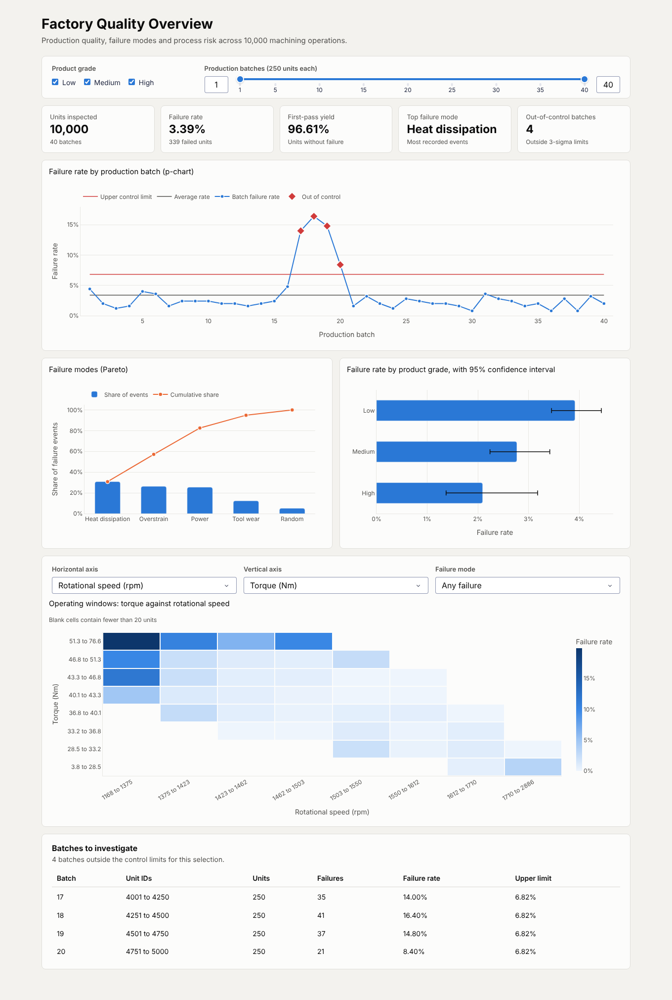
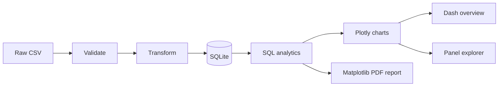
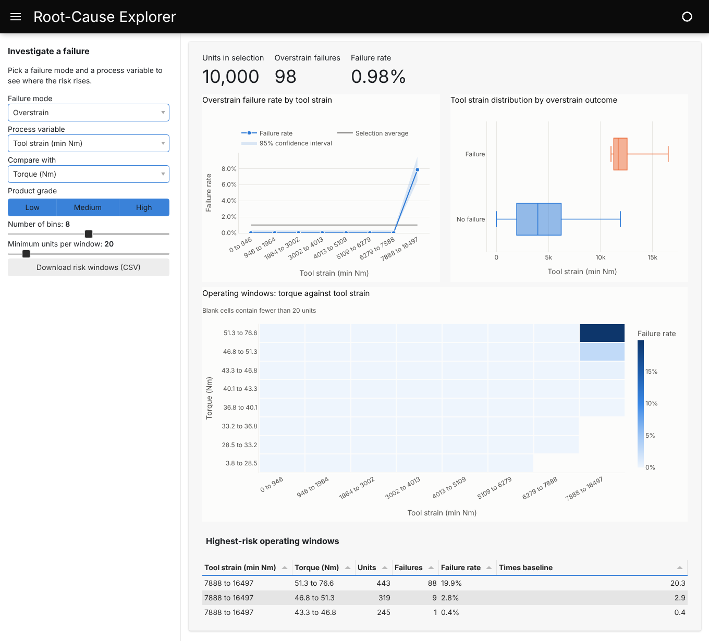
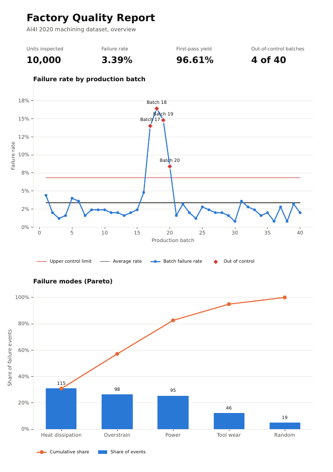

# Factory Quality Analytics

An end-to-end manufacturing quality project: a Python and SQL ETL pipeline feeds a Dash monitoring dashboard, a Panel root-cause explorer and a Matplotlib PDF report.



## What it answers

- Is production quality stable from batch to batch?
- Which failure modes cause the most problems?
- Which operating conditions carry the highest risk?
- Can the source data be trusted?

## Key findings

| Finding | Result |
|---|---|
| Overall quality | 339 of 10,000 units failed, a failure rate of 3.39% |
| Biggest failure modes | Heat dissipation, overstrain and power make up 83% of 373 failure events |
| Process stability | Batches 17 to 20 exceed the upper control limit of 6.82% |
| Likely cause of the spike | Heat dissipation causes 77% of failure events in those batches, against 3% in all others |
| Supporting signal | The average process-air temperature gap falls to 8.4 K in those batches, against 10.2 K elsewhere |
| Highest-risk window | 51.3 to 76.6 Nm at 1168 to 1375 rpm: 19.9% failure rate, 5.9 times the baseline |
| Product grade | Low-grade units fail at 3.92%, against 2.09% for high-grade units |
| Data quality | 9 failures have no recorded mode, and 18 recorded modes have no machine failure |

## How each tool is used

| Tool | Role in the project |
|---|---|
| **Python, pandas** | Extracts, validates and transforms the raw data |
| **SQL (SQLite)** | Stores the cleaned data and powers parameterized analysis queries |
| **Plotly** | Provides the interactive charts shared by both apps |
| **Dash** | Quality overview with KPIs, a p-chart, a Pareto chart and operating-window heatmaps |
| **Panel** | Root-cause explorer with failure-mode drill-down and a CSV export of risk windows |
| **Matplotlib** | Three-page PDF report that can be shared without running a server |
| **pytest, GitHub Actions** | Automated tests for the pipeline, analysis and every output |

## Architecture



## Run it

Requires Python 3.12 or newer.

**Windows (PowerShell)**

```powershell
py -m venv .venv
.\.venv\Scripts\Activate.ps1
pip install -r requirements.txt
```

**macOS or Linux**

```bash
python3 -m venv .venv
source .venv/bin/activate
pip install -r requirements.txt
```

**Then run:**

```bash
python run.py all     # Build the database and the PDF report
python run.py dash    # Open http://127.0.0.1:8050
python run.py panel   # Opens http://127.0.0.1:5006
pytest                # Run the tests
```

## Root-cause explorer



## PDF report

The generated report is in [`reports/quality_report.pdf`](reports/quality_report.pdf).



## Project structure

```text
factory-quality-analytics/
├── data/raw/ai4i2020.csv     Source data
├── docs/                     Screenshots
├── quality_lab/
│   ├── config.py             Paths, labels and settings
│   ├── etl.py                Extract, validate, transform and load
│   ├── analytics.py          SQL queries and statistics
│   ├── charts.py             Plotly figures
│   ├── dash_app.py           Dash quality overview
│   ├── panel_app.py          Panel root-cause explorer
│   ├── report.py             Matplotlib PDF report
│   └── assets/style.css      Dash styling
├── reports/                  Generated PDF report
├── tests/                    Automated tests
└── run.py                    Command-line entry point
```

## Methods

- **Data validation:** nine rules check IDs, missing values, grades, sensor ranges and label consistency. Critical problems stop the pipeline, and label conflicts are recorded for review.
- **Feature engineering:** power, tool strain and the process-air temperature gap are calculated from the raw sensors.
- **Statistical process control:** a p-chart flags batches beyond three standard deviations from the average failure rate.
- **Pareto analysis:** failure modes are ranked by their share of all failure events.
- **Uncertainty:** failure rates by grade and process variable use 95% Wilson confidence intervals.
- **Operating windows:** two process variables are split into equal-count bins, and small samples are hidden.

## Data and limitations

This project uses the [AI4I 2020 Predictive Maintenance Dataset](https://archive.ics.uci.edu/dataset/601) from the UCI Machine Learning Repository, licensed under [CC BY 4.0](https://creativecommons.org/licenses/by/4.0/) ([DOI: 10.24432/C5HS5C](https://doi.org/10.24432/C5HS5C)).

- The dataset is synthetic and models a milling process, so these findings do not describe a real factory.
- It has no timestamps, so batches of 250 units follow unit ID order.
- The temperature gap is associated with the spike in batches 17 to 20. Confirming the cause would need process records from a real line.
